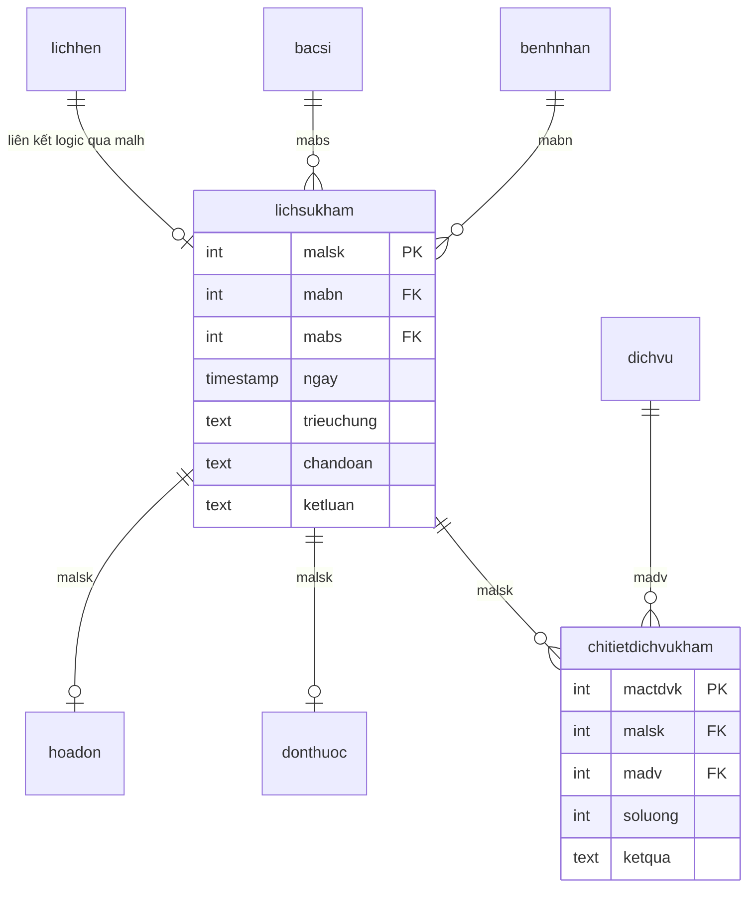

# Kế Hoạch Xây Dựng API Bác Sĩ Tạo Phiếu Khám Bệnh & Chỉ Định Cận Lâm Sàng

## 1. Mục tiêu (Goal Description)
Xây dựng phân hệ API hoàn chỉnh phục vụ nghiệp vụ khám chữa bệnh của Bác sĩ tại phòng khám:
1. **Tạo phiếu khám bệnh (`lichsukham`)**: Bác sĩ tiếp nhận bệnh nhân (theo lịch hẹn hoặc khám trực tiếp), ghi nhận triệu chứng ban đầu, chẩn đoán sơ bộ và kết luận.
2. **Chỉ định cận lâm sàng (`chitietdichvukham`)**: Bác sĩ chỉ định danh sách các dịch vụ xét nghiệm, chẩn đoán hình ảnh (X-Quang, Siêu âm, Nội soi...) cho bệnh nhân trong cùng lượt khám.
3. **Cập nhật kết quả cận lâm sàng**: Cho phép kỹ thuật viên/bác sĩ cập nhật kết quả khám cận lâm sàng để bác sĩ chính đưa ra chẩn đoán xác định.
4. **Liên kết nghiệp vụ tự động**: 
   - Tự động chuyển trạng thái lịch hẹn (`lichhen`) sang `DaKham` khi tạo phiếu khám theo lịch hẹn.
   - Sẵn sàng đồng bộ hóa đơn viện phí (`hoadon`, `chitiethoadon`) với hệ thống thanh toán.

---

## 2. Mô hình dữ liệu & Quan hệ CSDL (Prisma Schema)

Dựa trên cấu trúc database PostgreSQL hiện tại trong `schema.prisma`:



---

## 3. Danh sách Endpoints Đề Xuất (`/api/examinations`)

| Method | Endpoint | Quyền hạn (Roles) | Chức năng |
| :--- | :--- | :--- | :--- |
| **POST** | `/api/examinations` | `BacSi`, `Admin` | Tạo phiếu khám bệnh mới (kèm chỉ định cận lâm sàng & cập nhật lịch hẹn) |
| **GET** | `/api/examinations` | `BacSi`, `Admin`, `LeTan` | Lấy danh sách phiếu khám (hỗ trợ lọc `mabn`, `mabs`, khoảng ngày, search, phân trang) |
| **GET** | `/api/examinations/:id` | `BacSi`, `Admin`, `LeTan` | Xem chi tiết 1 phiếu khám (kèm dịch vụ cận lâm sàng, kết quả, đơn thuốc, viện phí) |
| **PUT** | `/api/examinations/:id` | `BacSi`, `Admin` | Cập nhật chẩn đoán, triệu chứng, kết luận của phiếu khám |
| **POST** | `/api/examinations/:id/services` | `BacSi`, `Admin` | Chỉ định thêm dịch vụ cận lâm sàng cho lần khám đã tạo |
| **PUT** | `/api/examinations/:id/services/:detailId` | `BacSi`, `Admin`, `YTa` | Cập nhật kết quả cận lâm sàng (`ketqua`) cho từng dịch vụ |
| **DELETE** | `/api/examinations/:id/services/:detailId` | `BacSi`, `Admin` | Hủy một chỉ định cận lâm sàng (Safe Guard: chặn nếu đã thanh toán) |
| **DELETE** | `/api/examinations/:id` | `Admin` | Xóa phiếu khám bệnh (Safe Guard: chỉ xóa khi chưa có hóa đơn thanh toán/đơn thuốc) |

---

## 4. Chi tiết Nghiệp Vụ & Thiết Kế API

### 4.1. Tạo phiếu khám bệnh & chỉ định cận lâm sàng
- **Endpoint:** `POST /api/examinations`
- **Headers:** `Authorization: Bearer <TOKEN>` (Role `BacSi` hoặc `Admin`)
- **Logic xử lý:**
  1. Nếu người gọi là `BacSi`, tự động truy xuất `mabs` từ tài khoản đang đăng nhập (`req.user.matk -> nhanvien -> bacsi`), tránh tình trạng tạo giả mạo bác sĩ khác. Nếu là `Admin`, cho phép truyền `mabs` tùy chọn.
  2. Xác thực bệnh nhân `mabn` tồn tại trong hệ thống.
  3. Nếu có truyền `malh` (mã lịch hẹn):
     - Kiểm tra lịch hẹn có tồn tại và đúng bệnh nhân `mabn` không.
     - Cập nhật trạng thái `lichhen` thành `DaKham`.
  4. Nếu có danh sách `services`:
     - Kiểm tra từng mã `madv` có tồn tại trong bảng `dichvu` hay không.
     - Kiểm tra số lượng hợp lệ (`soluong >= 1`).
  5. Thực thi qua **Prisma `$transaction`** để đảm bảo tính nguyên tử (Atomic):
     - Tạo bản ghi `lichsukham`.
     - Tạo đồng loạt các bản ghi `chitietdichvukham`.
- **Request Body mẫu:**
```json
{
  "mabn": 1,
  "malh": 5,
  "trieuchung": "Sốt nhẹ, đau rát họng 3 ngày, nuốt khó",
  "chandoan": "Theo dõi Viêm amidan cấp",
  "ketluan": "Chỉ định nội soi tai mũi họng và xét nghiệm công thức máu",
  "services": [
    {
      "madv": 2,
      "soluong": 1
    },
    {
      "madv": 4,
      "soluong": 1
    }
  ]
}
```

### 4.2. Cập nhật kết quả cận lâm sàng
- **Endpoint:** `PUT /api/examinations/:id/services/:detailId`
- **Role:** `BacSi`, `Admin`, `YTa`
- **Request Body mẫu:**
```json
{
  "ketqua": "Niêm mạc họng đỏ rực, amidan 2 bên sưng nề độ II có giả mạc trắng rải rác."
}
```

### 4.3. Chỉ định bổ sung dịch vụ cận lâm sàng
- **Endpoint:** `POST /api/examinations/:id/services`
- **Request Body mẫu:**
```json
{
  "services": [
    {
      "madv": 5,
      "soluong": 1
    }
  ]
}
```

---

## 5. Kế hoạch thay đổi mã nguồn (Proposed Changes)

### Component: Backend Modules

#### [NEW] `backend/src/validators/examination.validator.js`
- Validate `id` (mã lần khám), `detailId` (mã chi tiết dịch vụ khám).
- Validate payload tạo phiếu khám: `mabn` (bắt buộc, số nguyên dương), `trieuchung`, `chandoan`, `ketluan`, mảng `services` (`madv`, `soluong`).
- Validate payload cập nhật kết quả: `ketqua` (chuỗi ký tự, tối đa 2000 ký tự).
- Validate query parameters tìm kiếm & phân trang: `mabn`, `mabs`, `fromDate`, `toDate`, `search`, `page`, `limit`.

#### [NEW] `backend/src/services/examination.service.js`
- `createExaminationService(data, user)`: Tạo phiếu khám + dịch vụ cận lâm sàng + update lịch hẹn (Transaction).
- `getAllExaminationsService(query, user)`: Lọc và phân trang danh sách phiếu khám.
- `getExaminationByIdService(id, user)`: Lấy chi tiết phiếu khám đầy đủ thông tin liên quan.
- `updateExaminationService(id, data, user)`: Cập nhật chẩn đoán/kết luận của bác sĩ.
- `addServicesToExaminationService(id, services, user)`: Chỉ định bổ sung cận lâm sàng.
- `updateServiceResultService(id, detailId, ketqua, user)`: Nhập kết quả cận lâm sàng.
- `removeServiceFromExaminationService(id, detailId, user)`: Xóa chỉ định cận lâm sàng (kiểm tra an toàn hóa đơn).
- `deleteExaminationService(id, user)`: Xóa phiếu khám (Safe Delete Guard).

#### [NEW] `backend/src/controllers/examination.controller.js`
- Xử lý request/response, bắt lỗi HTTP status code tương ứng (201, 200, 400, 403, 404, 409).

#### [NEW] `backend/src/routers/examination.router.js`
- Đăng ký các route cùng middleware xác thực `authMiddleware` và phân quyền `roleMiddleware("BacSi", "Admin", ...)`.

#### [MODIFY] `backend/src/app.js`
- Đăng ký mount router: `app.use("/api/examinations", examinationRoutes);`

#### [MODIFY] `API_FRONTEND_GUIDE.md`
- Bổ sung mục tài liệu chuẩn: **14. PHÂN HỆ KHÁM BỆNH & CHỈ ĐỊNH CẬN LÂM SÀNG (`/api/examinations`)** với đầy đủ cURL, mẫu JSON request & response.

---

## 6. Kế hoạch Kiểm Thử & Xác Minh (Verification Plan)

### Kiểm thử tự động / Script kiểm tra
- Chạy script Node.js kiểm tra cú pháp và tính tương thích của router, controller, validator:
  ```bash
  node -e "require('./src/routers/examination.router'); console.log('Router loaded successfully');"
  ```

### Kiểm thử thủ công trên Hoppscotch
1. **Case 1 (Thành công):** Đăng nhập tài khoản Bác sĩ/Admin -> `POST /api/examinations` với danh sách cận lâm sàng. Kiểm tra CSDL tạo thành công bản ghi `lichsukham` và `chitietdichvukham`.
2. **Case 2 (Cập nhật kết quả cận lâm sàng):** `PUT /api/examinations/:id/services/:detailId` -> Kiểm tra trường `ketqua` được lưu chính xác.
3. **Case 3 (Cập nhật chẩn đoán):** `PUT /api/examinations/:id` -> Thay đổi chẩn đoán xác định sau khi có kết quả cận lâm sàng.
4. **Case 4 (Bảo vệ phân quyền):** Dùng token `BenhNhan` gọi `POST /api/examinations` -> Bị chặn với lỗi `403 Forbidden`.
5. **Case 5 (Validation):** Truyền `mabn` không tồn tại hoặc `madv` không hợp lệ -> Bị chặn với lỗi `400 Bad Request` hoặc `404 Not Found`.

> [!NOTE]
> Sau khi bạn xem xét và duyệt kế hoạch này, tôi sẽ bắt đầu triển khai code chi tiết cho các file trên.
