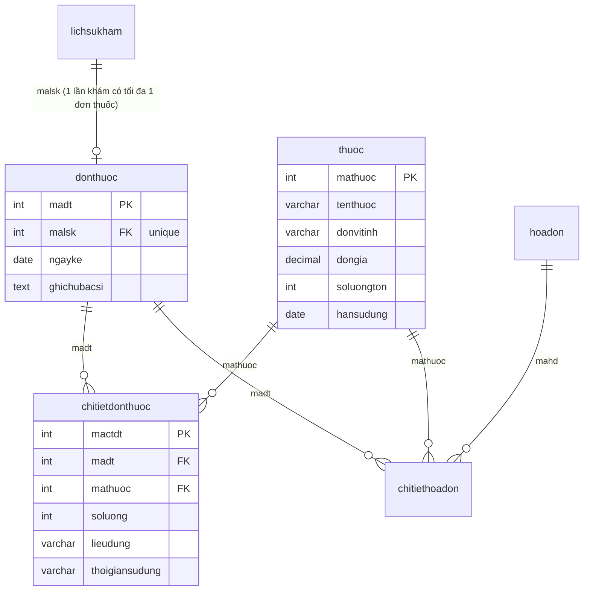
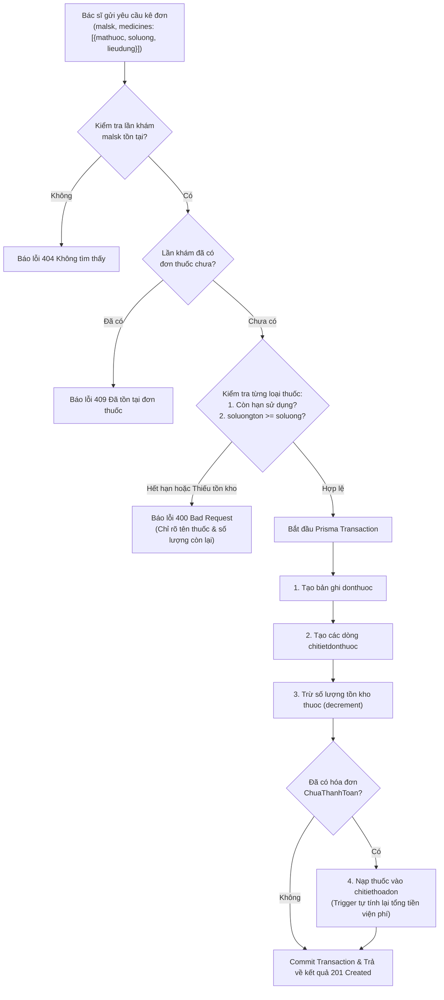

# Kế Hoạch Xây Dựng API Kê Đơn Thuốc Điện Tử & Tự Động Kiểm Tra/Trừ Tồn Kho Thuốc

## 1. Mục tiêu (Goal Description)
Xây dựng phân hệ API hoàn chỉnh phục vụ nghiệp vụ **Kê đơn thuốc điện tử** dành cho Bác sĩ và phòng khám:
1. **Kê đơn thuốc điện tử (`donthuoc`, `chitietdonthuoc`)**: Bác sĩ kê danh sách các loại thuốc, liều lượng, cách dùng, thời gian uống và ghi chú dặn dò cho bệnh nhân sau khi có chẩn đoán lâm sàng (`malsk`).
2. **Kiểm tra tồn kho & Hạn sử dụng thời gian thực (Real-time Inventory & Expiry Validation)**:
   - Tự động phát hiện và chặn thuốc đã hết hạn sử dụng (`hansudung < NOW()`).
   - Tự động kiểm tra số lượng tồn kho (`soluongton >= soluong`). Nếu số lượng trong kho không đủ hoặc thuốc đã hết hàng (`soluongton = 0`), lập tức chặn và báo lỗi chi tiết đến từng tên thuốc.
3. **Trừ kho thuốc tự động (Atomic Stock Deduction)**:
   - Sử dụng Prisma Transaction nguyên tử để tạo đơn thuốc và trừ trực tiếp số lượng tồn kho (`decrement: soluong`).
4. **Hoàn trả tồn kho khi hủy đơn (Stock Rollback)**:
   - Khi bác sĩ hủy đơn thuốc hợp lệ, hệ thống tự động hoàn lại số lượng thuốc vào kho (`increment: soluong`).
5. **Tích hợp tự động với Hóa đơn viện phí (`hoadon`, `chitiethoadon`)**:
   - Nếu lần khám đã phát sinh hóa đơn viện phí (`ChuaThanhToan`), hệ thống tự động đồng bộ danh sách thuốc và đơn giá vào chi tiết hóa đơn để thu ngân thu tiền viện phí.
6. **Bảo vệ toàn vẹn dữ liệu (Safe Guard)**: Chặn sửa hoặc hủy đơn thuốc nếu hóa đơn của lượt khám đã được thanh toán (`DaThanhToan`).

---

## 2. Mô hình CSDL & Luồng Nghiệp Vụ Kê Đơn

### 2.1. Sơ đồ Quan hệ Bảng (Prisma Schema)


### 2.2. Luồng Xử lý Nghiệp vụ Kê Đơn Thuốc


---

## 3. Danh sách Endpoints Đề Xuất (`/api/prescriptions`)

| Method | Endpoint | Quyền (Roles) | Chức năng |
| :--- | :--- | :--- | :--- |
| **POST** | `/api/prescriptions` | `BacSi`, `Admin` | Kê đơn thuốc điện tử (kiểm tra HSD, kiểm tra tồn kho, tự động trừ kho, đồng bộ hóa đơn) |
| **GET** | `/api/prescriptions` | `BacSi`, `Admin`, `LeTan`, `YTa` | Lấy danh sách đơn thuốc (lọc theo `mabn`, `mabs`, `malsk`, khoảng ngày, phân trang) |
| **GET** | `/api/prescriptions/:id` | `BacSi`, `Admin`, `LeTan`, `YTa`, `BenhNhan` | Xem chi tiết 1 đơn thuốc (kèm thông tin thuốc, liều dùng, thành tiền, thông tin bác sĩ/bệnh nhân) |
| **GET** | `/api/prescriptions/exam/:examId` | `BacSi`, `Admin`, `LeTan`, `YTa`, `BenhNhan` | Tra cứu đơn thuốc theo mã lần khám bệnh (`malsk`) |
| **PUT** | `/api/prescriptions/:id` | `BacSi`, `Admin` | Cập nhật đơn thuốc (liều lượng, ghi chú dặn dò) |
| **DELETE** | `/api/prescriptions/:id` | `BacSi`, `Admin` | Hủy đơn thuốc (hoàn trả tồn kho thuốc, xóa khỏi hóa đơn nếu chưa thanh toán) |

---

## 4. Chi tiết Thiết Kế Nghiệp Vụ & Dữ Liệu API

### 4.1. Kê đơn thuốc điện tử (`POST /api/prescriptions`)
- **Headers:** `Authorization: Bearer <TOKEN>` (Role `BacSi` hoặc `Admin`)
- **Request Body mẫu:**
```json
{
  "malsk": 12,
  "ghichubacsi": "Uống sau khi ăn no 30 phút. Uống nhiều nước ấm, kiêng đồ uống có cồn.",
  "medicines": [
    {
      "mathuoc": 1,
      "soluong": 20,
      "lieudung": "Sáng 1 viên, tối 1 viên sau ăn",
      "thoigiansudung": "10 ngày"
    },
    {
      "mathuoc": 3,
      "soluong": 10,
      "lieudung": "1 viên khi sốt trên 38.5 độ C, cách tối thiểu 4 - 6 giờ",
      "thoigiansudung": "Uống khi sốt"
    }
  ]
}
```
- **Xử lý an toàn CSDL:**
  1. Kiểm tra thuốc hết hạn -> Báo lỗi `400`: *"Thuốc [Tên thuốc] đã hết hạn sử dụng vào ngày [DD/MM/YYYY], không thể kê đơn!"*
  2. Kiểm tra tồn kho -> Báo lỗi `400`: *"Thuốc [Tên thuốc] chỉ còn [X] đơn vị trong kho, không đủ để kê [Y] đơn vị!"*
  3. Chặn kê trùng một thuốc nhiều dòng trong cùng đơn.
  4. Trừ kho nguyên tử bằng `decrement`.

- **Response Thành công (201 Created):**
```json
{
  "success": true,
  "message": "Kê đơn thuốc điện tử và cập nhật trừ kho thành công!",
  "data": {
    "madt": 8,
    "malsk": 12,
    "ngayke": "2026-10-24",
    "ghichubacsi": "Uống sau khi ăn no 30 phút...",
    "benhnhan": {
      "mabn": 1,
      "hoten": "Nguyễn Văn An",
      "sdt": "0912345678",
      "diung": "Dị ứng Aspirin"
    },
    "bacsi": {
      "mabs": 2,
      "hoten": "BS. Trần Văn Bình",
      "chuyenkhoa": "Khoa Tai Mũi Họng"
    },
    "chitietdonthuoc": [
      {
        "mactdt": 25,
        "mathuoc": 1,
        "tenthuoc": "Amoxicillin 500mg",
        "donvitinh": "Viên",
        "dongia": 3500,
        "soluong": 20,
        "thanhtien": 70000,
        "lieudung": "Sáng 1 viên, tối 1 viên sau ăn",
        "thoigiansudung": "10 ngày"
      }
    ],
    "tongtienthuoc": 110000,
    "trangthaihoadon": "ChuaThanhToan"
  }
}
```

### 4.2. Hủy đơn thuốc & Hoàn trả tồn kho (`DELETE /api/prescriptions/:id`)
- **Safe Guard:** Nếu hóa đơn viện phí của lần khám đã thanh toán (`DaThanhToan`), chặn không cho hủy đơn thuốc để bảo vệ chứng từ tài chính.
- **Hoàn trả kho:** Duyệt qua tất cả thuốc trong đơn, tự động cộng lại số lượng vào bảng `thuoc` (`increment: soluong`).

---

## 5. Kế hoạch Thay Đổi Mã Nguồn (Proposed Changes)

### Component: Backend Modules

#### [NEW] `backend/src/validators/prescription.validator.js`
- `validatePrescriptionId`: Kiểm tra `id` trên params là số nguyên dương.
- `validateExamIdParam`: Kiểm tra `examId` trên params là số nguyên dương.
- `validateCreatePrescription`: Kiểm tra bắt buộc `malsk`, danh sách `medicines` không rỗng, mỗi thuốc có `mathuoc > 0`, `soluong > 0`, `lieudung`, `thoigiansudung`.
- `validateUpdatePrescription`: Kiểm tra `ghichubacsi`, `medicines` nếu có cập nhật.
- `validatePrescriptionQuery`: Kiểm tra bộ lọc `mabn`, `mabs`, `malsk`, khoảng ngày, phân trang.

#### [NEW] `backend/src/services/prescription.service.js`
- `createPrescriptionService(data, user)`: Thực thi kiểm tra hạn dùng, kiểm tra tồn kho, trừ tồn kho và đồng bộ hóa đơn trong Prisma Transaction.
- `getAllPrescriptionsService(query, user)`: Lọc, phân trang danh sách đơn thuốc, phân quyền bệnh nhân chỉ xem đơn của mình.
- `getPrescriptionByIdService(id, user)`: Xem chi tiết đơn thuốc kèm thông tin thuốc, liều dùng, bác sĩ, bệnh nhân.
- `getPrescriptionByExamIdService(examId, user)`: Xem đơn thuốc theo mã lần khám.
- `updatePrescriptionService(id, data, user)`: Cập nhật ghi chú dặn dò hoặc liều dùng.
- `deletePrescriptionService(id, user)`: Hủy đơn thuốc kèm cơ chế hoàn trả tồn kho (`increment`) và bảo vệ hóa đơn.

#### [NEW] `backend/src/controllers/prescription.controller.js`
- Tiếp nhận HTTP request, gọi service và phản hồi JSON API chuẩn (201, 200, 400, 403, 404, 409).

#### [NEW] `backend/src/routers/prescription.router.js`
- Đăng ký các endpoints với phân quyền RBAC (`BacSi`, `Admin`, `LeTan`, `YTa`, `BenhNhan`).

#### [MODIFY] `backend/src/app.js`
- Mount route: `app.use("/api/prescriptions", prescriptionRoutes)`.

#### [MODIFY] `API_FRONTEND_GUIDE.md`
- Bổ sung tài liệu chuẩn: **15. PHÂN HỆ KÊ ĐƠN THUỐC ĐIỆN TỬ & QUẢN LÝ XUẤT THUỐC (`/api/prescriptions`)** với đầy đủ mẫu JSON, cURL và ghi chú nghiệp vụ.

---

## 6. Kế hoạch Kiểm Thử & Xác Minh (Verification Plan)

### Automated Syntax & Integration Check
```bash
node -e "
const app = require('./src/app');
const presRouter = require('./src/routers/prescription.router');
console.log('Prescription module loaded and verified successfully!');
"
```

### Manual Testing trên Hoppscotch
1. **Case 1 (Kê đơn thuốc thành công):** Kê đơn cho lần khám `malsk = 1` với thuốc có sẵn trong kho -> Kiểm tra đơn thuốc được tạo và `soluongton` của thuốc tự động giảm đi đúng số lượng kê.
2. **Case 2 (Chặn kê đơn thuốc hết hạn):** Kê loại thuốc có `hansudung < hôm nay` -> Hệ thống trả về `400 Bad Request` thông báo thuốc đã hết hạn.
3. **Case 3 (Chặn kê đơn vượt quá tồn kho):** Kê số lượng 1000 viên trong khi kho chỉ còn 50 viên -> Hệ thống trả về `400 Bad Request` thông báo số lượng tồn kho không đủ.
4. **Case 4 (Chặn kê trùng 1 lần khám):** Kê đơn lần thứ 2 cho cùng 1 `malsk` -> Hệ thống trả về `409 Conflict`.
5. **Case 5 (Hủy đơn & hoàn lại tồn kho):** Hủy đơn thuốc -> Kiểm tra `soluongton` trong kho được tự động cộng lại nguyên vẹn.
6. **Case 6 (Bảo vệ hóa đơn đã thanh toán):** Cố tình hủy đơn thuốc khi hóa đơn đã `DaThanhToan` -> Hệ thống trả về `400 Bad Request` chặn thao tác.

> [!NOTE]
> Mời bạn xem xét và phê duyệt kế hoạch này. Khi bạn đồng ý, tôi sẽ tiến hành triển khai mã nguồn chi tiết cho các file trên.
