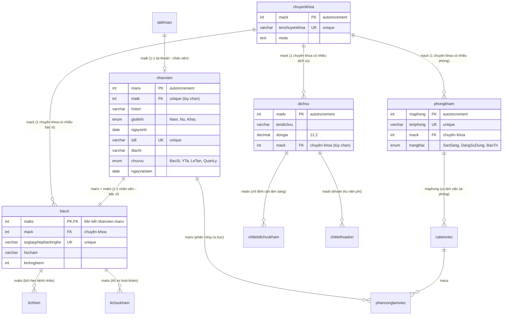
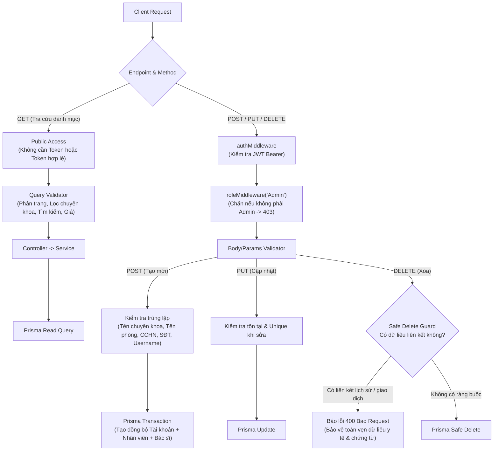

# Kế Hoạch Xây Dựng & Chuẩn Hóa Master Data API: Chuyên Khoa, Bác Sĩ, Phòng Khám, Dịch Vụ

## 1. Mục Tiêu (Goal Description)
Xây dựng và hoàn thiện phân hệ **Master Data API (Dữ liệu danh mục cốt lõi)** cho Hệ thống Quản lý Phòng khám, bao gồm 4 phân hệ chính:
1. **Chuyên khoa (`/api/specialties`)**: Quản lý danh mục chuyên khoa khám chữa bệnh, phục vụ trang chủ, dropdown đặt lịch và phân loại dịch vụ/bác sĩ/phòng khám.
2. **Bác sĩ (`/api/doctors`)**: Quản lý hồ sơ nhân sự bác sĩ, số giấy phép hành nghề (CCHN), học hàm, số năm kinh nghiệm, liên kết 1-1 với nhân viên (`nhanvien`) và tài khoản đăng nhập (`taikhoan`), tra cứu lịch ca trực (`/schedule`).
3. **Phòng khám (`/api/rooms`)**: Quản lý cơ sở vật chất, phòng chức năng, phân loại theo chuyên khoa và kiểm soát trạng thái phòng (`SanSang`, `DangSuDung`, `BaoTri`).
4. **Dịch vụ (`/api/services`)**: Quản lý danh mục kỹ thuật và bảng giá dịch vụ khám bệnh, cận lâm sàng (xét nghiệm, chẩn đoán hình ảnh...), liên kết chuyên khoa, phục vụ bác sĩ chỉ định và thu ngân tính viện phí.

Kế hoạch này tập trung vào:
- Rà soát kiến trúc 3 tầng (`Router` $\to$ `Middleware/Validator` $\to$ `Controller` $\to$ `Service` $\to$ `Prisma DB`).
- Chuẩn hóa các bộ hằng số (`constants`) đồng bộ theo `DEVELOPMENT_GUIDE.md`.
- Chuẩn hóa ép kiểu và kiểm tra dữ liệu đầu vào (`validators`).
- Cơ chế bảo vệ dữ liệu y tế an toàn (**Safe Delete Guards**) và giao dịch nguyên tử (**Prisma Transactions**).
- Xây dựng bộ kịch bản kiểm thử tự động toàn diện (**Automated Test Suite**) cho toàn bộ 20+ endpoint Master Data.

---

## 2. Mô Hình Dữ Liệu & Kiến Trúc Nghiệp Vụ

### 2.1. Sơ đồ Thực thể Liên kết (Entity-Relationship Diagram)


### 2.2. Luồng Phân Quyền & Bảo Vệ Dữ Liệu Master Data


---

## 3. Yêu Cầu Xem Xét Từ Phía Người Dùng (User Review Required)

> [!IMPORTANT]
> **Quy tắc Xóa An Toàn (Safe Delete Guards):**
> 1. **Chuyên khoa**: Không được xóa nếu còn Bác sĩ, Phòng khám hoặc Dịch vụ trực thuộc.
> 2. **Bác sĩ**: Không được xóa nếu đã từng có Lịch hẹn (`lichhen`), Lượt khám bệnh (`lichsukham`), hoặc Ca làm việc (`phanconglamviec`). Thay vì xóa cứng, bác sĩ sẽ được khóa tài khoản (`KhoaTaiKhoan`).
> 3. **Phòng khám**: Không được xóa nếu đã có Ca làm việc (`calamviec`) được phân công. Thay vào đó chuyển trạng thái sang `BaoTri`.
> 4. **Dịch vụ**: Không được xóa nếu đã phát sinh Chỉ định khám (`chitietdichvukham`) hoặc Hóa đơn viện phí (`chitiethoadon`).

> [!NOTE]
> **Cấp tài khoản Bác sĩ:**
> Khi tạo mới Bác sĩ (`POST /api/doctors`), người quản trị có thể tùy chọn cung cấp `username` và `password` để tạo tài khoản Bác sĩ ngay trong cùng một Transaction nguyên tử, hoặc chỉ tạo hồ sơ nhân sự trước.

---

## 4. Câu Hỏi Mở & Điểm Thống Nhất (Open Questions)

- **Quy chuẩn xóa mềm vs xóa cứng:** Hiện tại các bảng trong CSDL (`quanlyphongkham_postgresql.sql`) chưa có cột `is_deleted`. Toàn bộ Safe Delete Guard hiện tại đang chặn xóa cứng nếu có dữ liệu liên kết và chỉ xóa cứng khi bảng hoàn toàn không có dữ liệu tham chiếu. Điều này đã hoàn toàn khớp với tài liệu tích hợp `API_FRONTEND_GUIDE.md`.

---

## 5. Danh Mục Đổi Mới & Chuẩn Hóa Chi Tiết (Proposed Changes)

### Phân hệ 1: Bổ sung Hằng số Chuẩn hóa (`constants`)
Tạo mới các file constants cho Chuyên khoa, Bác sĩ và Dịch vụ theo đúng chuẩn của `DEVELOPMENT_GUIDE.md` (hiện dự án mới chỉ có `room.constant.js`).

#### [NEW] `backend/src/constants/specialty.constant.js`
- Khai báo các giới hạn độ dài tên chuyên khoa (2-100), độ dài mô tả tối đa (1000).
- Thông báo lỗi và quy chuẩn phân trang mặc định (page=1, limit=10, maxLimit=100).

#### [NEW] `backend/src/constants/doctor.constant.js`
- Khai báo hằng số chức vụ `CHUC_VU = { BAC_SI: "BacSi", ... }`.
- Giới hạn kinh nghiệm (0 - 70 năm), định dạng số điện thoại 10 chữ số chuẩn Việt Nam (`/^0\d{9}$/`).
- Các giới hạn độ dài họ tên, số CCHN (3-50 ký tự).

#### [NEW] `backend/src/constants/service.constant.js`
- Khai báo giới hạn độ dài tên dịch vụ (2-150 ký tự).
- Giới hạn đơn giá (tối thiểu 0 VNĐ, tối đa 1.000.000.000 VNĐ).

---

### Phân hệ 2: Chuẩn Hóa Bộ Kiểm Tra Dữ Liệu Đầu Vào (`validators`)
Đảm bảo tính nhất quán giữa các validator: tự động chuẩn hóa và gán lại kiểu số (`Number`) vào `req.query` để các service không bị lệch kiểu dữ liệu chuỗi/số.

#### [MODIFY] `backend/src/validators/specialty.validator.js`
- Gán giá trị số chuẩn hóa `req.query.page = pageNum`, `req.query.limit = limitNum`.
- Nhập các hằng số từ `specialty.constant.js`.

#### [MODIFY] `backend/src/validators/room.validator.js`
- Gán giá trị số chuẩn hóa `req.query.page = pageNum`, `req.query.limit = limitNum`.

#### [MODIFY] `backend/src/validators/service.validator.js`
- Gán giá trị số chuẩn hóa `req.query.minPrice = min`, `req.query.maxPrice = max`, `req.query.page = pageNum`, `req.query.limit = limitNum`.
- Nhập các hằng số từ `service.constant.js`.

#### [MODIFY] `backend/src/validators/doctor.validator.js`
- Nhập các hằng số từ `doctor.constant.js`.

---

### Phân hệ 3: Bắt Lỗi Toàn Vẹn Khóa Ngoại (`error.middleware.js`)
Nâng cấp middleware xử lý lỗi tập trung để bắt mã lỗi `P2003` của Prisma (Foreign Key Constraint Violation) và phản hồi mã lỗi `400 Bad Request` thân thiện thay vì văng lỗi `500 Internal Server Error`.

#### [MODIFY] `backend/src/middlewares/error.middleware.js`
- Thêm xử lý lỗi:
  ```javascript
  if (err.code === "P2003") {
      statusCode = 400;
      message = "Không thể thực hiện thao tác do vi phạm ràng buộc dữ liệu liên kết!";
  }
  ```

---

### Phân hệ 4: Bộ Kịch Bản Kiểm Thử Tự Động Master Data (`tests`)
Tạo file kiểm thử tự động kiểm tra toàn bộ luồng hoạt động của 4 phân hệ Master Data:
- Đăng nhập lấy Token Quản trị viên (`Admin`).
- CRUD Chuyên khoa & kiểm tra Safe Delete.
- CRUD Phòng khám & kiểm tra lọc theo trạng thái, chuyên khoa.
- CRUD Dịch vụ & kiểm tra lọc theo khoảng giá `minPrice`/`maxPrice`.
- CRUD Bác sĩ trong Transaction (tạo cả Account + Employee + Doctor), kiểm tra lọc ca trực (`/schedule`) và Safe Delete.

#### [NEW] `backend/scripts/test_master_data.js`
- Kịch bản Node.js chạy tự động kiểm thử hơn 20 tình huống (thành công, lỗi trùng tên, lỗi vi phạm ràng buộc xóa, lỗi xác thực quyền truy cập).

---

## 6. Kế Hoạch Xác Minh & Kiểm Thử (Verification Plan)

### 6.1. Kiểm thử Tự động (Automated Tests)
1. **Kiểm tra cú pháp tĩnh (Syntax & Lint Check):**
   ```powershell
   Get-ChildItem -Recurse .\backend\src\*.js | ForEach-Object { node --check $_.FullName }
   ```
2. **Chạy kịch bản kiểm thử tích hợp Master Data API:**
   ```powershell
   node backend/scripts/test_master_data.js
   ```

### 6.2. Kiểm thử Thủ công (Manual Verification Matrix)
| # | Phân hệ | Endpoint | Hành động kiểm tra | Kết quả mong đợi |
|---|---|---|---|---|
| 1 | Chuyên khoa | `GET /api/specialties?includeCounts=true` | Gọi công khai không cần token | Trả về 200 kèm `_count` bác sĩ, phòng, dịch vụ |
| 2 | Chuyên khoa | `POST /api/specialties` | Tạo chuyên khoa mới bằng token Admin | Trả về 201 Created |
| 3 | Chuyên khoa | `DELETE /api/specialties/:id` | Xóa chuyên khoa đang có bác sĩ | Bị chặn, trả về 400 Bad Request |
| 4 | Bác sĩ | `POST /api/doctors` | Thêm bác sĩ kèm username/password | Trả về 201, tạo thành công đồng thời cả 3 bảng |
| 5 | Bác sĩ | `GET /api/doctors/:id/schedule` | Lấy lịch trực bác sĩ | Trả về 200 kèm danh sách ca trực |
| 6 | Bác sĩ | `DELETE /api/doctors/:id` | Xóa bác sĩ đã có lịch hẹn / khám | Bị chặn, trả về 400 với thông báo chi tiết số lượng |
| 7 | Phòng khám | `GET /api/rooms?status=SanSang` | Lọc phòng theo trạng thái | Trả về 200 chỉ các phòng sẵn sàng |
| 8 | Phòng khám | `DELETE /api/rooms/:id` | Xóa phòng đã có ca làm việc | Bị chặn, trả về 400 |
| 9 | Dịch vụ | `GET /api/services?minPrice=100000&maxPrice=300000` | Lọc dịch vụ theo khoảng giá | Trả về 200 các dịch vụ trong tầm giá |
| 10 | Dịch vụ | `DELETE /api/services/:id` | Xóa dịch vụ đã gắn hóa đơn | Bị chặn, trả về 400 |
| 11 | Phân quyền | `POST /api/specialties` | Gọi không kèm token hoặc token Bệnh nhân | Trả về 401 Unauthorized / 403 Forbidden |
