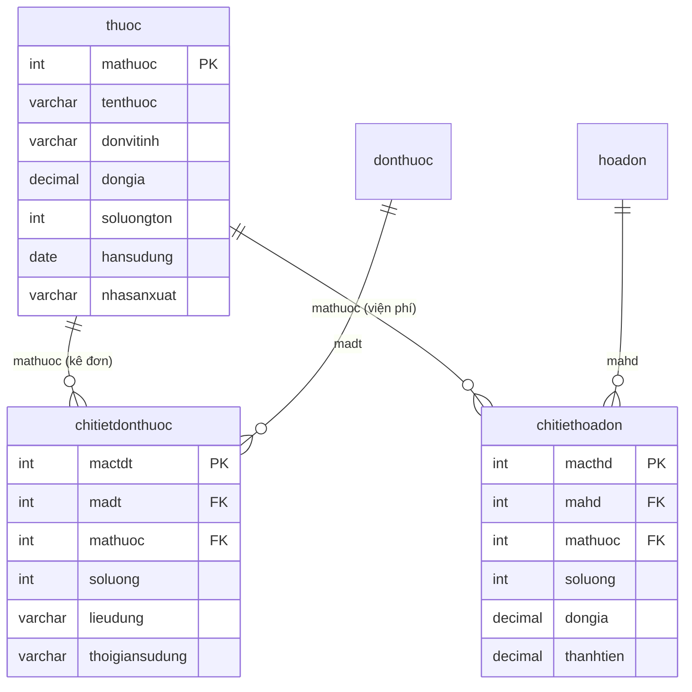

# Kế Hoạch Xây Dựng API Quản Lý Kho Thuốc, Danh Mục Dược Phẩm & Cảnh Báo Tồn Kho

## 1. Mục tiêu (Goal Description)
Xây dựng phân hệ API hoàn chỉnh phục vụ công tác quản lý dược phẩm, xuất nhập tồn kho thuốc và cảnh báo rủi ro tại phòng khám:
1. **Danh mục Dược phẩm (`thuoc`)**: Cho phép Admin/Quản lý quản lý thông tin các loại thuốc (tên, hoạt chất, đơn vị tính, đơn giá, nhà sản xuất, hạn sử dụng, số lượng tồn).
2. **Nhập kho & Điều chỉnh tồn kho (Stock Management)**: 
   - Nhập thêm thuốc vào kho (tăng số lượng tồn, cập nhật đơn giá hoặc hạn sử dụng mới).
   - Kiểm kê và điều chỉnh số lượng tồn thực tế (ghi nhận lý do hư hỏng, thất thoát, hủy thuốc hết hạn).
3. **Cảnh báo thông minh (Smart Inventory Alerts)**:
   - **Cảnh báo tồn kho thấp (Low Stock Alert)**: Tự động phát hiện các thuốc có `soluongton <= ngưỡng` (mặc định `<= 10`) hoặc đã hết sạch hàng (`soluongton = 0`).
   - **Cảnh báo hết hạn & cận hạn (Expiry Alert)**: Tự động phát hiện các thuốc đã quá hạn sử dụng (`hansudung < NOW()`) hoặc cận hạn trong vòng 30 - 90 ngày tới.
4. **Dashboard thống kê kho thuốc (Inventory Analytics)**: Tổng hợp tổng số lượng loại thuốc, tổng giá trị tài sản dược phẩm tồn kho (`∑ soluongton * dongia`), số lượng thuốc cần nhập bổ sung khẩn cấp.
5. **Safe Delete Guard (Bảo vệ chứng từ y tế)**: Chặn xóa thuốc nếu thuốc đó đã phát sinh trong đơn thuốc của bệnh nhân (`chitietdonthuoc`) hoặc đã xuất hóa đơn viện phí (`chitiethoadon`).

---

## 2. Mô hình CSDL & Quan hệ Bảng (Prisma Schema)

Dựa trên cấu trúc database PostgreSQL hiện tại trong `schema.prisma`:



---

## 3. Danh sách Endpoints Đề Xuất (`/api/medicines`)

| Method | Endpoint | Quyền (Roles) | Chức năng |
| :--- | :--- | :--- | :--- |
| **GET** | `/api/medicines` | Public / All Roles | Lấy danh sách thuốc (tìm kiếm, lọc theo khoảng giá, trạng thái tồn kho, phân trang) |
| **GET** | `/api/medicines/alerts` | `Admin`, `BacSi`, `YTa` | Lấy danh sách cảnh báo tồn kho (hết hàng, sắp hết hàng, đã hết hạn, cận hạn) |
| **GET** | `/api/medicines/stats/overview` | `Admin` | Thống kê tổng quan kho thuốc (tổng giá trị tồn, số loại thuốc theo trạng thái) |
| **GET** | `/api/medicines/:id` | Public / All Roles | Xem chi tiết thông tin thuốc & trạng thái tồn kho |
| **POST** | `/api/medicines` | `Admin` | Thêm loại thuốc mới vào danh mục dược phẩm |
| **PUT** | `/api/medicines/:id` | `Admin` | Cập nhật thông tin thuốc (tên, giá, đơn vị tính, NSX, HSD) |
| **POST** | `/api/medicines/:id/import` | `Admin` | Nhập thêm số lượng thuốc vào kho (kèm cập nhật HSD/giá nếu có) |
| **PUT** | `/api/medicines/:id/stock` | `Admin` | Điều chỉnh tồn kho thực tế khi kiểm kê (kèm lý do điều chỉnh) |
| **DELETE** | `/api/medicines/:id` | `Admin` | Xóa thuốc khỏi danh mục (Safe Delete Guard: chặn xóa nếu đã có đơn thuốc/hóa đơn) |

---

## 4. Chi tiết Thiết Kế Nghiệp Vụ & Dữ Liệu API

### 4.1. Cảnh báo tồn kho & hạn dùng (`GET /api/medicines/alerts`)
- **Query Parameters:**
  - `threshold` (number, mặc định `10`): Ngưỡng số lượng tồn cảnh báo sắp hết hàng.
  - `days` (number, mặc định `30`): Số ngày tính cận hạn sử dụng.
- **Dữ liệu trả về phân nhóm rõ ràng:**
  - `outOfStock`: Danh sách thuốc có `soluongton = 0` (hết hàng).
  - `lowStock`: Danh sách thuốc có `0 < soluongton <= threshold` (sắp hết hàng).
  - `expired`: Danh sách thuốc có `hansudung < NOW()` (đã hết hạn - cần tiêu hủy ngay).
  - `nearExpiry`: Danh sách thuốc có `NOW() <= hansudung <= NOW() + days` (cận hạn).

### 4.2. Nhập thêm hàng vào kho (`POST /api/medicines/:id/import`)
- **Request Body:**
```json
{
  "soluong": 200,                  // Số lượng nhập thêm (bắt buộc, > 0)
  "hansudung": "2027-12-31",       // Cập nhật HSD mới của lô nhập (tùy chọn)
  "dongia": 5500,                  // Cập nhật đơn giá bán mới nếu có biến động (tùy chọn)
  "ghichu": "Nhập lô thuốc mới theo hóa đơn nhập kho HD-NK-0012"
}
```
- **Xử lý:** Cộng dồn `soluongton += soluong`, cập nhật `hansudung` và `dongia` nếu có.

### 4.3. Kiểm kê & điều chỉnh tồn kho (`PUT /api/medicines/:id/stock`)
- **Request Body:**
```json
{
  "soluongton": 45,               // Số lượng tồn thực tế sau kiểm kê (>= 0)
  "lydo": "Kiểm kê định kỳ tháng 10: phát hiện vỡ 5 lọ trong quá trình vận chuyển"
}
```

### 4.4. Safe Delete Guard khi xóa thuốc (`DELETE /api/medicines/:id`)
- Nếu thuốc đã được bác sĩ kê trong `chitietdonthuoc` hoặc đã xuất hóa đơn `chitiethoadon`:
  - Trả về `400 Bad Request`.
  - Thông báo rõ ràng: *"Thuốc đã phát sinh trong [X] đơn thuốc và [Y] hóa đơn viện phí, không thể xóa để đảm bảo toàn vẹn dữ liệu y tế! Nếu không còn kinh doanh, hãy cập nhật số lượng tồn về 0."*

---

## 5. Kế hoạch thay đổi mã nguồn (Proposed Changes)

### Component: Backend Modules

#### [NEW] `backend/src/constants/medicine.constant.js`
- Định nghĩa ngưỡng tồn kho mặc định: `DEFAULT_LOW_STOCK_THRESHOLD = 10`.
- Định nghĩa số ngày cận hạn mặc định: `DEFAULT_EXPIRY_WARNING_DAYS = 30`.
- Danh sách trạng thái tồn kho hợp lệ: `IN_STOCK`, `LOW_STOCK`, `OUT_OF_STOCK`, `EXPIRED`, `NEAR_EXPIRY`.

#### [NEW] `backend/src/validators/medicine.validator.js`
- `validateMedicineId`: Kiểm tra `id` là số nguyên dương.
- `validateMedicineQuery`: Kiểm tra query `search`, `minPrice`, `maxPrice`, `stockStatus`, `page`, `limit`.
- `validateCreateMedicine`: Kiểm tra bắt buộc `tenthuoc`, `donvitinh`, `dongia > 0`, `hansudung`, `soluongton >= 0`.
- `validateUpdateMedicine`: Kiểm tra ít nhất 1 trường cần sửa và tính hợp lệ kiểu dữ liệu.
- `validateImportStock`: Kiểm tra `soluong > 0`, `hansudung`, `dongia`.
- `validateAdjustStock`: Kiểm tra `soluongton >= 0` và lý do điều chỉnh `lydo`.
- `validateAlertQuery`: Kiểm tra `threshold > 0`, `days > 0`.

#### [NEW] `backend/src/services/medicine.service.js`
- `getAllMedicinesService(query)`: Lọc, tìm kiếm, phân trang và gắn nhãn trạng thái thuốc.
- `getMedicineByIdService(id)`: Lấy chi tiết thuốc kèm số lượt kê đơn/hóa đơn.
- `createMedicineService(data, user)`: Tạo mới thuốc.
- `updateMedicineService(id, data, user)`: Cập nhật thông tin thuốc.
- `importMedicineStockService(id, data, user)`: Nhập hàng tăng số lượng tồn kho.
- `adjustMedicineStockService(id, data, user)`: Điều chỉnh tồn kho kiểm kê.
- `getInventoryAlertsService(params)`: Trích xuất danh sách cảnh báo tồn & hạn dùng.
- `getInventoryOverviewStatsService()`: Thống kê tổng hợp số lượng & giá trị kho thuốc.
- `deleteMedicineService(id, user)`: Xóa thuốc kèm Safe Delete Guard.

#### [NEW] `backend/src/controllers/medicine.controller.js`
- Tiếp nhận HTTP requests, điều phối service và trả về HTTP status chuẩn (201, 200, 400, 403, 404).

#### [NEW] `backend/src/routers/medicine.router.js`
- Đăng ký các endpoints với phân quyền RBAC (`Admin`, `BacSi`, `YTa`).

#### [MODIFY] `backend/src/app.js`
- Mount route: `app.use("/api/medicines", medicineRoutes)`.

#### [MODIFY] `API_FRONTEND_GUIDE.md`
- Bổ sung tài liệu chuẩn: **15. PHÂN HỆ QUẢN LÝ KHO THUỐC, DƯỢC PHẨM & CẢNH BÁO TỒN KHO (`/api/medicines`)** với đầy đủ mẫu JSON, cURL và hướng dẫn tích hợp.

---

## 6. Kế hoạch Kiểm Thử & Xác Minh (Verification Plan)

### Automated Syntax & Integration Check
```bash
node -e "
const app = require('./src/app');
const medicineRouter = require('./src/routers/medicine.router');
console.log('Medicine module integrated and verified successfully!');
"
```

### Manual Testing trên Hoppscotch / Postman
1. **Case 1 (Thêm thuốc mới):** `POST /api/medicines` tạo thuốc "Paracetamol 500mg", số lượng 50, HSD 2027-12-31.
2. **Case 2 (Cảnh báo tồn kho):** `GET /api/medicines/alerts?threshold=15&days=60` -> Kiểm tra các nhóm thuốc hết hàng, sắp hết hàng, cận hạn.
3. **Case 3 (Nhập thêm kho):** `POST /api/medicines/:id/import` nhập thêm 100 viên -> Kiểm tra số lượng tồn tăng lên 150.
4. **Case 4 (Kiểm kê kho):** `PUT /api/medicines/:id/stock` cập nhật tồn kho về 140 viên (hao hụt 10 viên).
5. **Case 5 (Safe Delete Guard):** Tạo đơn thuốc có dùng thuốc này, sau đó gọi `DELETE /api/medicines/:id` -> Xác nhận server chặn xóa với mã lỗi `400 Bad Request`.
6. **Case 6 (Bảo vệ phân quyền):** Dùng tài khoản `BenhNhan` gọi API nhập kho hoặc xóa thuốc -> Xác nhận trả về `403 Forbidden`.

> [!NOTE]
> Mời bạn xem xét và duyệt kế hoạch này. Khi bạn phê duyệt, tôi sẽ tiến hành tạo các file và triển khai mã nguồn chi tiết.
